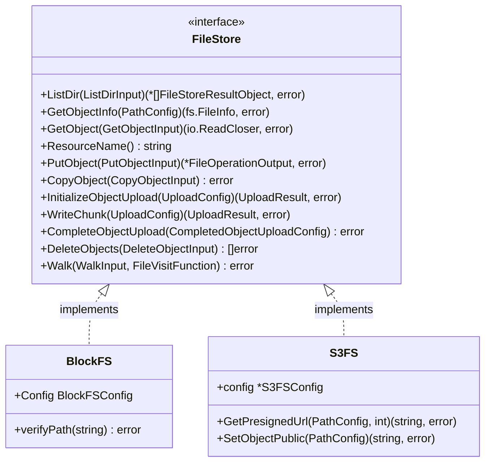

# filesapi

`filesapi` is a Go package that provides a unified, high-level interface for interacting with different storage backends. Whether you are working with a local filesystem or cloud-native object storage like AWS S3 (or Minio), `filesapi` abstracts the underlying complexities, offering a consistent API for file management, multipart uploads, and directory traversal.

## Tech Stack & Dependencies

* **Language:** Go 1.21+
* **Major Dependencies:**
    * `github.com/aws/aws-sdk-go-v2`: For S3 and STS integration.
    * `github.com/google/uuid`: For generating unique upload identifiers.

## Architecture

The core of the library is the `FileStore` interface. Implementations of this interface handle the specifics of the storage medium while adhering to the same method signatures.



## Getting Started

### Installation

```bash
go get github.com/usace-cloud-compute/filesapi
```

### Basic Usage (Local Filesystem)

```go
import "github.com/usace-cloud-compute/filesapi"

func main() {
    cfg := filesapi.BlockFSConfig{
        BaseDir: "/tmp/my-storage",
        ChunkSize: 10 * 1024 * 1024, // 10MB
    }
    
    store, err := filesapi.NewFileSystemStore(cfg)
    if err != nil {
        panic(err)
    }

    // Upload a file
    _, err = store.PutObject(filesapi.PutObjectInput{
        Source: filesapi.ObjectSource{
            Data: []byte("Hello, World!"),
        },
        Dest: filesapi.PathConfig{
            Path: "/hello.txt",
        },
    })
}
```

## Interface & Methods

### `FileStore` Interface

The `FileStore` interface defines the standard operations available across all storage implementations.

| Method | Parameters | Returns | Description |
| :--- | :--- | :--- | :--- |
| `ListDir` | `ListDirInput` | `*[]FileStoreResultObject, error` | Lists contents of a directory with pagination and filtering. |
| `GetObjectInfo` | `PathConfig` | `fs.FileInfo, error` | Retrieves metadata for a specific resource. |
| `GetObject` | `GetObjectInput` | `io.ReadCloser, error` | Retrieves the content of a resource (supports byte range requests). |
| `ResourceName` | *None* | `string` | Returns the name of the storage resource (e.g., bucket name). |
| `PutObject` | `PutObjectInput` | `*FileOperationOutput, error` | Uploads an object from a source to a destination. |
| `CopyObject` | `CopyObjectInput` | `error` | Copies an object within the same store. |
| `InitializeObjectUpload` | `UploadConfig` | `UploadResult, error` | Starts a new multipart upload session. |
| `WriteChunk` | `UploadConfig` | `UploadResult, error` | Writes a specific chunk of data to an ongoing multipart upload. |
| `CompleteObjectUpload` | `CompletedObjectUploadConfig` | `error` | Finalizes a multipart upload. |
| `DeleteObjects` | `DeleteObjectInput` | `[]error` | Recursively deletes objects matching the provided path pattern. |
| `Walk` | `WalkInput, FileVisitFunction` | `error` | Recursively traverses the store starting at the given path. |

---

## Data Structures & Configuration

### Core Types

#### `PathConfig`
Represents a resource path. Can support multiple paths for multi-file resources (like shapefiles).

| Parameter | Type | Required? | Description |
| :--- | :--- | :--- | :--- |
| `Path` | `string` | No | The primary single path. |
| `Paths` | `[]string` | No | An array of paths for multi-file resources. |
| `Context` | `context.Context` | No | Optional context for method execution. |

#### `ObjectSource`
Defines where the data for an upload originates.

| Parameter | Type | Required? | Description |
| :--- | :--- | :--- | :--- |
| `Reader` | `io.Reader` | No | An existing reader. |
| `Data` | `[]byte` | No | A raw byte slice. |
| `Filepath` | `PathConfig` | No | A path to a resource to be read. |
| `ContentLength` | `*int64` | No | Optional content length. |

### Implementation Configurations

#### `BlockFSConfig` (Local Filesystem)

| Parameter | Type | Required? | Description |
| :--- | :--- | :--- | :--- |
| `BaseDir` | `string` | Yes | The root directory for all operations. |
| `ChunkSize` | `int64` | No | Size of chunks for multipart uploads. |

#### `S3FSConfig` (AWS S3 / Minio)

| Parameter | Type | Required? | Description |
| :--- | :--- | :--- | :--- |
| `S3Region` | `string` | Yes | AWS Region (e.g., `us-east-1`). |
| `S3Bucket` | `string` | Yes | Target S3 bucket name. |
| `Delimiter` | `string` | No | Delimiter for directory-like structures. |
| `MaxKeys` | `int32` | No | Max keys returned per list request. |
| `Credentials` | `any` | Yes | Either `S3FS_Static` or `S3FS_Attached`. |
| `AssumedRole` | `string` | No | ARN for cross-account role assumption. |

**Credential Options for S3:**

1. **`S3FS_Static`**:
   * `S3Id`: Access Key ID.
   * `S3Key`: Secret Access Key.
2. **`S3FS_Attached`**:
   * `Profile`: AWS shared config profile name.

### Input Objects

#### `PutObjectInput`

| Parameter | Type | Required? | Description |
| :--- | :--- | :--- | :--- |
| `Source` | `ObjectSource` | Yes | The data source. |
| `Dest` | `PathConfig` | Yes | The destination path. |
| `Multipart` | `bool` | No | Whether to use multipart upload (S3). |
| `Encryption` | `EncryptionStrategy` | No | `DEFAULT`, `AES`, or `VENDOR`. |
| `ContentDispostion` | `*string` | No | An optional content disposition if supported by the file system.  Ignored otherwise. |

#### `ListDirInput`

| Parameter | Type | Required? | Description |
| :--- | :--- | :--- | :--- |
| `Path` | `PathConfig` | Yes | The directory to list. |
| `Page` | `int` | No | Page number for paginated results. |
| `Size` | `int32` | No | Number of items per page. |
| `Filter` | `string` | No | String filter for results. |
| `Context` | `context.Context` | No | Optional context. |

#### `UploadConfig`

| Parameter | Type | Required? | Description |
| :--- | :--- | :--- | :--- |
| `ObjectPath` | `string` | Yes | Target path for the upload. |
| `ChunkId` | `int32` | Yes | 0-indexed chunk number. |
| `UploadId` | `string` | Yes | The identifier for the multipart session. |
| `Data` | `[]byte` | Yes | The chunk data. |
| `Context` | `context.Context` | No | Optional context. |

#### `CompletedObjectUploadConfig`

| Parameter | Type | Required? | Description |
| :--- | :--- | :--- | :--- |
| `UploadId` | `string` | Yes | The identifier for the multipart session. |
| `ObjectPath` | `string` | Yes | Final destination path. |
| `ChunkUploadIds` | `[]string` | Yes | List of ETags for each uploaded chunk. |
| `Context` | `context.Context` | No | Optional context. |

#### `WalkInput`

| Parameter | Type | Required? | Description |
| :--- | :--- | :--- | :--- |
| `Path` | `PathConfig` | Yes | Starting path for traversal. |
| `Progress` | `ProgressFunction` | No | Callback for progress updates. |
| `FsUseWalk` | `bool` | No | Use `filepath.Walk` instead of `WalkDir` (FS only). |
| `FsFullInfo` | `bool` | No | Return full `fs.FileInfo` (FS only). |
| `Context` | `context.Context` | No | Optional context. |


---

## Implementation Specifics

### `BlockFS` (Local Filesystem)
* **Security:** Enforces path traversal protection by verifying that all requested paths reside within the configured `BaseDir`.
* **Multipart Uploads:** Uses hidden staging files (prefixed with `.` and suffixed with `.tmp`) to manage chunks before finalization.

### `S3FS` (AWS S3 / Minio)
* **Multipart Support:** Leverages AWS S3's native multipart upload API.
* **S3-Specific Methods:**
    * `GetPresignedUrl(path PathConfig, days int) (string, error)`: Generates a temporary URL for public access to an object.
    * `SetObjectPublic(path PathConfig) (string, error)`: Sets the object ACL to `public-read` and returns the public URL.
